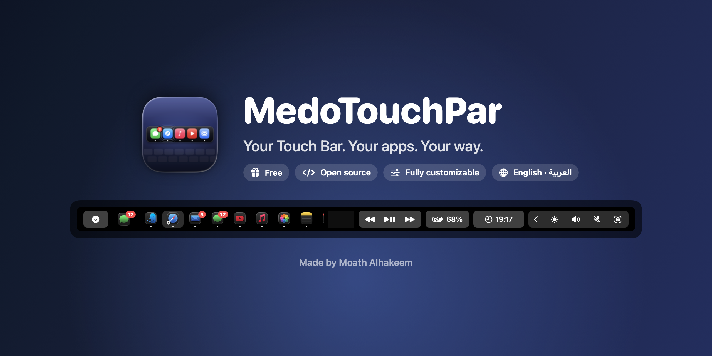
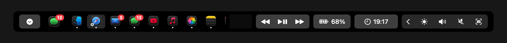
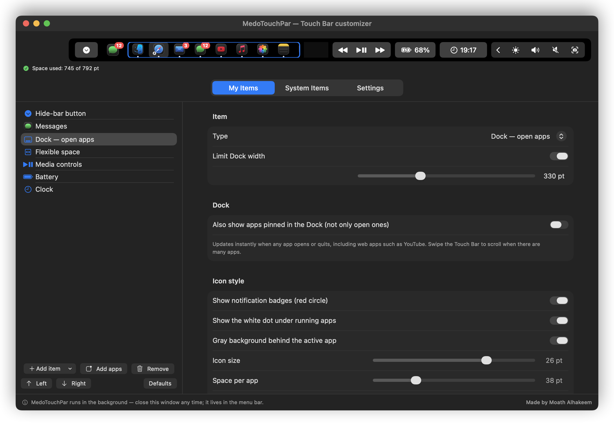
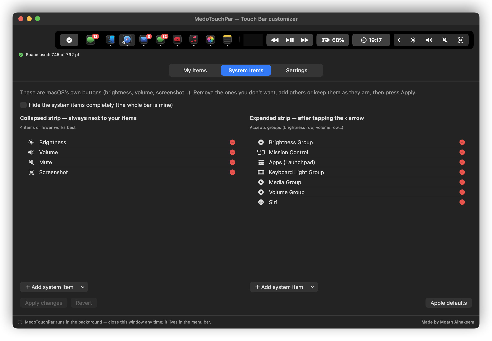
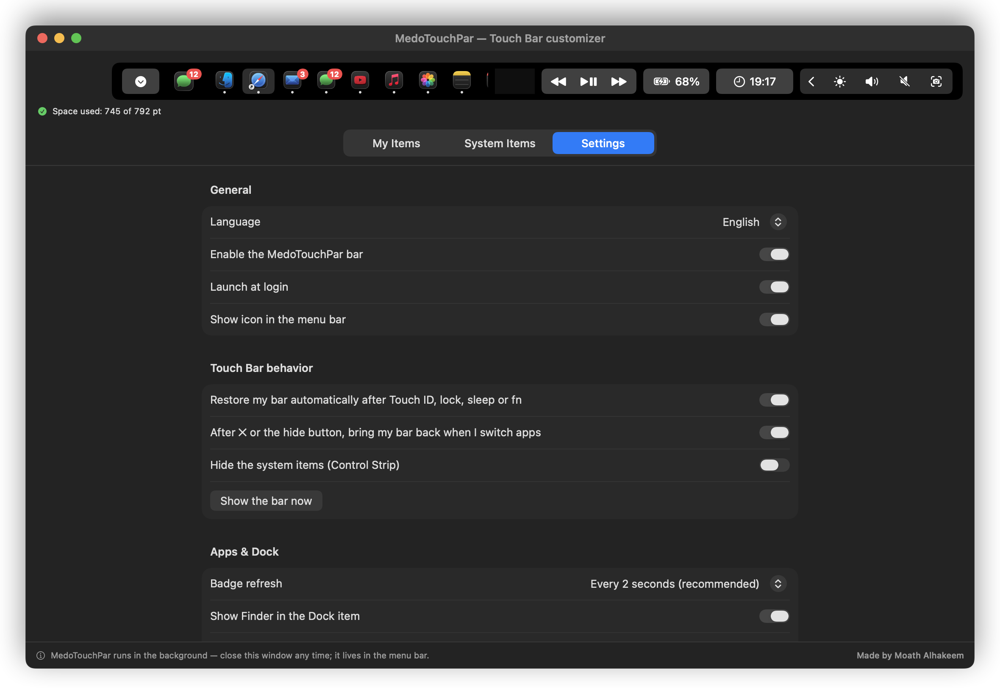
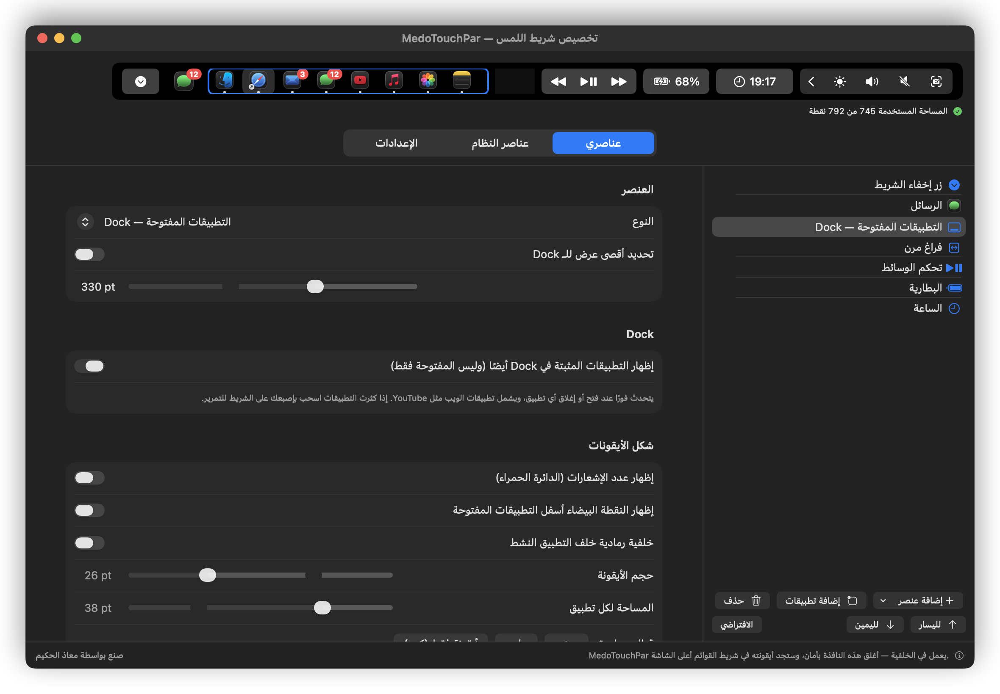
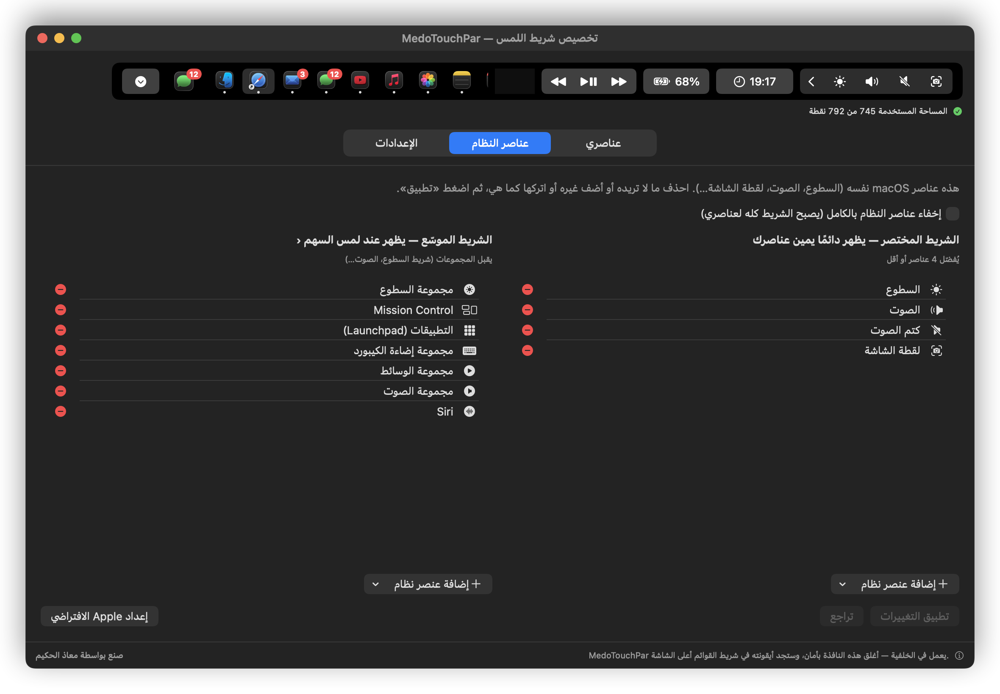
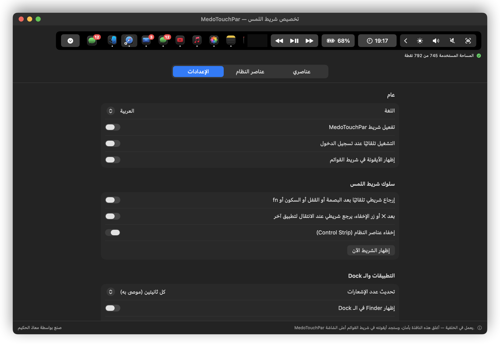
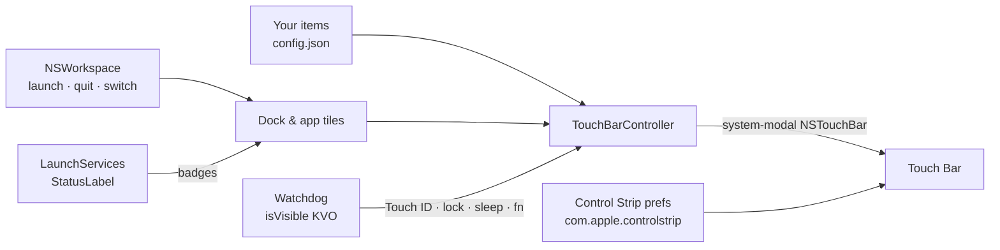
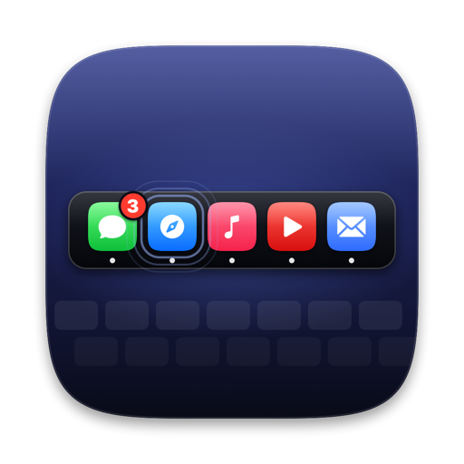

<div align="center">



# MedoTouchPar

**The free, open-source Touch Bar customizer for Mac.**
Put your real apps — with live notification badges — your Dock, media keys and shortcuts on the Touch Bar, and make every pixel yours.

[](#-requirements)
[](#-requirements)
[](#-requirements)
[](Sources/MedoTouchPar)
[](#-why-medotouchpar)
[](LICENSE)

[**Download**](https://github.com/Mo3athAmr/MedoTouchPar/releases/latest) ·
[Features](#-features) ·
[Screenshots](#-screenshots) ·
[Install](#-install) ·
[How it works](#-how-it-works) ·
[FAQ](#-faq) ·
[العربية](#-العربية)

<br>



<sub>The real preview from the app — badges update live and the active app is highlighted as you switch.</sub>

</div>

---

## ✨ Why MedoTouchPar?

<table>
<tr>
<td width="33%" align="center">

### 🆓 Free
No trial, no subscription, no account, no ads.
Open source under the MIT license — forever.

</td>
<td width="33%" align="center">

### ⚡ Easy
Install, open, tap **Add apps** — done.
A live, life-size preview shows exactly what your Touch Bar will look like.

</td>
<td width="33%" align="center">

### 🎛️ Fully customizable
Every item, icon size, spacing, color, dot, badge and system button is yours to change — in English or Arabic.

</td>
</tr>
</table>

---

## 🧩 Features

<details open>
<summary><b>📱 Apps & Dock — your real apps on the Touch Bar</b></summary>
<br>

| Feature | What it does |
|---|---|
| **App items** | Any app with its **real icon**. Tap to open it, or jump to it if it's already open — exactly like the Dock. |
| **Live notification badges** | The same red badge you see in the Dock (Messages, Mail, Telegram, WhatsApp…), updated live. |
| **Dock item** | All your **open apps** in Dock order, updated instantly when an app opens or quits. Optionally include the apps pinned in your Dock. |
| **Web apps too** | YouTube, X, Threads, TikTok… saved with Safari's *Add to Dock*, Chrome / Edge PWAs and Pake wrappers all show with their own icons and badges. |
| **Icon style** | Icon size (16–30 pt), space per app, running dot on/off, active-app highlight on/off, badges on/off. One-click presets: *Small*, *Regular*, *Icon only (large)*. |
| **Smart fitting** | The Dock shrinks to the space that's really left (for example when macOS shows its ✕) and scrolls with a swipe instead of disappearing. |

</details>

<details>
<summary><b>🧰 Widgets & buttons</b></summary>
<br>

| Item | Details |
|---|---|
| 🔘 **Custom button** | Title, SF Symbol icon (with a picker), background color, fixed width. |
| ⌨️ **Keyboard shortcut** | Record any shortcut, e.g. `⌘⇧4`, and fire it from the Touch Bar. |
| 🚀 **Open app / URL** | Searchable app picker that includes web apps. |
| 🖥️ **Terminal command** | Run any shell command with one tap. |
| 🎵 **Media controls** | Previous · Play/Pause · Next — works with Music, Spotify, YouTube. |
| 🔊 **Volume & ☀️ Brightness sliders** | Control the output volume and the built-in display brightness directly. |
| 🔋 **Battery** · 🕒 **Clock** | Live percentage with charging state; clock with any format (`HH:mm`, `h:mm a`, `EEE d MMM`…). |
| 🔒 **System actions** | Lock screen, turn display off, screenshot, Spotlight, Mission Control, show desktop, emoji picker. |
| ⬇️ **Hide-bar button** | Shows the current app's own Touch Bar tools; yours comes back when you switch apps. |
| ↔️ **Spaces** | Fixed and flexible spacers to lay everything out. |

</details>

<details>
<summary><b>🍎 System items (Control Strip)</b></summary>
<br>

- See macOS's **own** Touch Bar buttons — brightness, volume, mute, screenshot, Siri, Do Not Disturb, Night Shift and 25+ more.
- **Remove**, **add** or **reorder** them, or keep them exactly as they are.
- Edit both the **collapsed** strip (next to your items) and the **expanded** one (behind the ‹ arrow).
- Your original setup is backed up automatically — **Restore my original setup** or **Apple defaults** at any time.
- Or hide them completely and give the whole bar to your own items.

</details>

<details>
<summary><b>🛡️ Rock-solid behavior</b></summary>
<br>

- **Always comes back.** When Touch ID, a password prompt, the lock screen, sleep or the `fn` key take over the Touch Bar, MedoTouchPar waits and then restores your bar automatically.
- **✕ works the way you'd expect.** Tap the system ✕ (or the hide button) to use the current app's tools, for example Xcode. Switch to another app and your bar is back.
- **Instant updates.** Opening, quitting and switching apps update the bar immediately.
- **Lightweight.** Runs in the background with about 1% CPU and about 60 MB of memory, and no Dock icon.
- **Launch at login**, a menu-bar icon (optional) and live editing — changes apply instantly without flicker.

</details>

<details>
<summary><b>🎨 Customization & languages</b></summary>
<br>

- **Life-size preview** of the whole bar, including the system strip, with a space meter that warns before anything gets hidden.
- Drag to reorder, duplicate, right-click to remove, or press **Delete**.
- **Settings by feature:** language, launch at login, menu-bar icon, auto-restore, return-after-switch, badge refresh rate (1 / 2 / 5 s), Finder in the Dock, Accessibility status.
- **English and العربية**, with a full right-to-left layout for Arabic. Pick one or follow the system language.

</details>

---

## 📸 Screenshots

<div align="center">

**My Items** — add apps, the Dock, widgets and buttons; tune every detail


**System Items** — keep, remove or add macOS's own Touch Bar buttons


**Settings** — every feature has its own switch


</div>

<details>
<summary><b>🇸🇦 Arabic interface (right-to-left)</b></summary>
<br>
<div align="center">



</div>
</details>

---

## 📦 Install

### Option 1 — Download (easiest)

1. Download **MedoTouchPar.zip** from the [latest release](https://github.com/Mo3athAmr/MedoTouchPar/releases/latest).
2. Unzip it and drag **MedoTouchPar.app** to **Applications**.
3. The first time, **right-click → Open** (the app is free and not notarized by Apple), then confirm.

> [!TIP]
> If macOS still refuses to open it, run this once in Terminal:
> `xattr -dr com.apple.quarantine /Applications/MedoTouchPar.app`

### Option 2 — Build from source

```bash
git clone https://github.com/Mo3athAmr/MedoTouchPar.git
cd MedoTouchPar
./build.sh            # builds a universal app, installs it to /Applications and starts it
```

Requires Xcode (or the Command Line Tools) with Swift 5.9 or later. `./build.sh --no-install` only builds into `./build`.

### First run — 3 steps

| Step | |
|---|---|
| **1** | MedoTouchPar opens its window and appears in the menu bar. |
| **2** | Click **Add apps** and pick your favorites, or keep the default Dock item. |
| **3** | *(Optional)* Grant **Accessibility** in Settings so shortcut, media and lock buttons can press keys for you. |

That's it — you can close the window. MedoTouchPar keeps running in the background and starts with your Mac.

---

## 🧠 How it works



<details>
<summary><b>Technical details</b></summary>
<br>

- The bar is a normal `NSTouchBar` presented **system-wide** through AppKit's system-modal Touch Bar API (`DFRFoundation`), plus an icon in the Control Strip to bring it back.
- **Badges** are read from LaunchServices' `StatusLabel` — the same value the Dock draws — so no extra permission is needed.
- **Watchdog:** KVO on `NSTouchBar.isVisible` notices when the system takes the bar away. While an authentication prompt is on screen, the screen is locked or `fn` is held, it waits; otherwise it restores the bar.
- **System items** are edited through the same `com.apple.controlstrip` preferences that *System Settings › Keyboard › Touch Bar Settings* writes.
- Editing never re-presents the bar: one `NSTouchBar` is updated in place.
- These are private Apple interfaces, so a future macOS update could change them.

</details>

---

## ⚙️ Settings reference

| Setting | Default | Description |
|---|---|---|
| Language | System | English, العربية, or follow macOS |
| Launch at login | On | Starts silently in the background |
| Menu-bar icon | On | Hide it if you like; open the app again to get the window back |
| Restore automatically | On | Brings the bar back after Touch ID, lock, sleep or `fn` |
| Return after switching apps | On | After ✕ or the hide button, the bar returns when you switch apps |
| Hide system items | Off | Gives the whole bar to your items |
| Badge refresh | 2 s | 1 s, 2 s or 5 s (launch, quit and switch are always instant) |
| Finder in the Dock | On | Show or hide Finder in the Dock item |

---

## ❓ FAQ

<details>
<summary><b>Is it really free?</b></summary>
<br>
Yes. MedoTouchPar is free and open source under the MIT license — no trials, no in-app purchases, no tracking.
</details>

<details>
<summary><b>Does it collect any data?</b></summary>
<br>
No. The app makes no network requests. Your settings are stored locally in <code>~/Library/Application Support/MedoTouchPar/config.json</code>.
</details>

<details>
<summary><b>Why does it need Accessibility permission?</b></summary>
<br>
Only for buttons that press keys for you (keyboard shortcuts, media keys, lock screen). Apps, the Dock, badges, sliders, clock and battery work without it.
</details>

<details>
<summary><b>I tapped ✕ and my bar disappeared — how do I get it back?</b></summary>
<br>
Switch to another app and it returns automatically. You can also tap the MedoTouchPar icon in the Control Strip, or use <b>Show Touch Bar</b> from the menu-bar icon.
</details>

<details>
<summary><b>A badge doesn't show for an app</b></summary>
<br>
MedoTouchPar shows the same badge the app puts on its Dock icon. If the app has badges turned off (in its own settings, or in System Settings › Notifications), there's nothing to show.
</details>

<details>
<summary><b>Can I use it together with BetterTouchTool?</b></summary>
<br>
Yes, but turn off BetterTouchTool's Touch Bar feature — only one app can own the Touch Bar at a time.
</details>

<details>
<summary><b>How do I uninstall it?</b></summary>
<br>
Quit it from the menu-bar icon, then delete <code>/Applications/MedoTouchPar.app</code> and <code>~/Library/Application Support/MedoTouchPar</code>. To restore your original system buttons first, use <b>System Items › Restore my original setup</b>.
</details>

---

## 🖥️ Requirements

- A Mac **with a Touch Bar** (MacBook Pro 2016–2022), Intel or Apple Silicon. Developed and tuned on the 16″ MacBook Pro 2019.
- **macOS 13 Ventura** or later.

## 🤝 Contributing

Issues and pull requests are welcome. The project is a plain Swift package:

```
Sources/
├── TBPrivate/            Objective-C shim for the Touch Bar / LaunchServices / DisplayServices APIs
└── MedoTouchPar/
    ├── TouchBarController.swift   presents the bar, watchdog, item factories
    ├── AppTiles.swift             app tiles, badges, the scrolling Dock strip
    ├── Apps.swift                 running apps, Dock order, badges, installed-app catalog
    ├── ControlStripStore.swift    system items (Control Strip) editor
    ├── CustomizerView.swift       main window: My Items · System Items · Settings
    ├── ItemEditor.swift           per-item editor
    ├── TouchBarPreview.swift      life-size live preview
    ├── L10n.swift                 English / Arabic strings
    └── ScreenshotExporter.swift   regenerates the README images (--export-screenshots)
```

Regenerate the screenshots in this README with
`/Applications/MedoTouchPar.app/Contents/MacOS/MedoTouchPar --export-screenshots docs/images`. It uses a demo mode with sample apps, so no personal data ends up in the images.

---

## 🇸🇦 العربية

<div dir="rtl">

**MedoTouchPar** تطبيق **مجاني ومفتوح المصدر** لتخصيص شريط اللمس (Touch Bar) في الماك.

- 📱 **تطبيقاتك الحقيقية** على شريط اللمس بأيقوناتها الأصلية، مع **عدد الإشعارات** (الدائرة الحمراء) بشكل مباشر.
- 🧭 **Dock كامل** للتطبيقات المفتوحة يتحدث فورًا عند فتح أي تطبيق أو إغلاقه، ويشمل **تطبيقات الويب** مثل YouTube.
- 🎛️ **تخصيص كامل**: حجم الأيقونة، المساحة، النقطة البيضاء، الخلفية، الألوان، الأزرار، الاختصارات، الأوامر، الوسائط، السطوع، الصوت، البطارية والساعة.
- 🍎 **عناصر النظام**: اعرض أزرار macOS نفسها (السطوع، الصوت، لقطة الشاشة…) واحذفها أو أضف غيرها أو اتركها كما هي.
- 🛡️ **ثابت دائمًا**: يرجع شريطك تلقائيًا بعد البصمة أو القفل أو السكون، وزر ✕ يعرض أدوات التطبيق الحالي ويرجع شريطك عند الانتقال لتطبيق آخر.
- 🌍 **عربي وإنجليزي** مع واجهة من اليمين لليسار.
- ⚡ **خفيف**: يعمل في الخلفية بحوالي 1% من المعالج، ويبدأ تلقائيًا مع تشغيل الجهاز.

**التثبيت:** حمّل **MedoTouchPar.zip** من [آخر إصدار](https://github.com/Mo3athAmr/MedoTouchPar/releases/latest)، انقله إلى مجلد التطبيقات، ثم كليك يمين ← فتح في أول مرة. أو من المصدر:

</div>

```bash
git clone https://github.com/Mo3athAmr/MedoTouchPar.git && cd MedoTouchPar && ./build.sh
```

<div dir="rtl" align="center">

**صنع بواسطة معاذ الحكيم**

</div>

---

<div align="center">



**MedoTouchPar** — Made by **Moath Alhakeem** · صنع بواسطة **معاذ الحكيم**

If MedoTouchPar makes your Touch Bar better, please ⭐ the repository.

<sub>MIT License · Not affiliated with Apple. MacBook Pro and Touch Bar are trademarks of Apple Inc.</sub>

</div>
